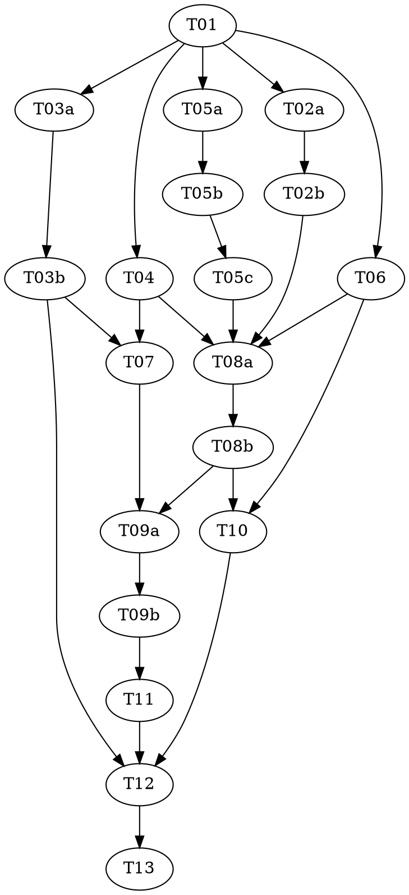

# hivemind 0.1 Implementation Plan

> **For Claude:** REQUIRED SUB-SKILL: Use superpowers:subagent-driven-development (parallel, same session) to implement this plan. It holds `pair` and `triad` tasks, so executing-plans can't run it.

**Goal:** Build `/hivemind`, a moderator-free swarm whose agents act only through priced physics
tools, argue in a gradual-argumentation graph, live and breed by an energy economy steered by an
entropy thermostat, and are harvested as coherent worldviews.

**Architecture:** A Node scheduler is the only writer: it runs agents as isolated Agent SDK
sessions (or scripted stubs in `hive sim`), implements their tools over one in-memory Hive backed
by graph files and an event log, and settles the economy on every tool-call tick. Pure modules
(strength, harvest, field, economy, thermostat, genome) hold every rule; I/O sits in the store,
the Hive, the scheduler, the runners and the CLI.

**Tech Stack:** Node ≥ 20, ES modules, `node:test`; `@anthropic-ai/claude-agent-sdk` 0.3.317 and
`zod` 4.6.7, pinned exactly.

**Spec:** `C:\work\claude\vanillafairy\docs\superpowers\specs\2026-11-03-hivemind-design.md`

**Planned by:** claude-opus-5-5

## Before wave 1 (orchestrator)

Create the repository the tasks build in:

```bash
mkdir C:/work/claude/vanillafairy/hivemind && cd C:/work/claude/vanillafairy/hivemind
git init -b master && git commit --allow-empty -m "Start hivemind"
```

Then the integration branch `hivemind-0.1` in its own worktree, as for any plan.

## Global Constraints

- Billing is the Claude Code subscription only; no code path reads or sets `ANTHROPIC_API_KEY`.
- Every agent runs isolated (`settingSources: []`, `strictMcpConfig: true`, auto-memory off).
- One model and effort for every agent, from `physics.run`.
- Only the scheduler writes the run directory; agents act only through the physics tools.
- A tick is one accepted agent tool call; nothing else advances the clock.
- Every tunable number lives in `physics.json`; no literal thresholds in code.
- No code imported from think-tank.

## Dispatch
| Stage | Model | Effort | Why |
|---|---|---|---|
| final-review | opus | medium | |

## Review Focus

1. A run reopened from disk after a crash must continue with the same books and clock → pinned in
   T08a ('a reopened hive has the same books and clock').
2. An agent asked to read `../../etc` or a sibling of a source folder must be refused → pinned in
   T08a ('source refuses paths outside the charter').
3. The plan's usage limit mid-run must pause, not crash or burn the remaining reserve → pinned in
   T09a ('the plan limit pauses and resumes the hive') and T10 ('a usage-limit error is reported
   as limit, not thrown').
4. A run started with `ANTHROPIC_API_KEY` set in the shell must still bill the subscription →
   pinned in T10 ('the environment keeps no API key or Claude variables except the config dir').
5. A whole run's books must balance to the energy put in → pinned in T05a ('the books balance under
   random operations') and T09a ('the books balance over a whole run').

---

## Dependency Graph

| Task | Role | Depends On | Files Created/Modified |
|------|------|-----------|------------------------|
| T01 | — | — | package.json, physics.json, src/graph/*, src/events.mjs, src/physics.mjs, test/graph+store |
| T02a | red | T01 | test/strength.test.mjs (authored), src/strength.mjs (stubs) |
| T02b | green | T02a | src/strength.mjs (test READ-ONLY) |
| T03a | red | T01 | test/dung+harvest (authored), src/dung.mjs, src/harvest.mjs (stubs) |
| T03b | green | T03a | src/dung.mjs, src/harvest.mjs (tests READ-ONLY) |
| T04 | — | T01 | src/field.mjs, test/field.test.mjs |
| T05a | red | T01 | test/economy.test.mjs (authored), src/economy.mjs (stubs) |
| T05b | green | T05a | src/economy.mjs (test READ-ONLY) |
| T05c | audit | T05b | — (a gap becomes tasks/T05d-economy-gaps.md) |
| T06 | — | T01 | src/genome.mjs, test/genome.test.mjs |
| T07 | — | T03b, T04 | src/thermostat.mjs, test/thermostat.test.mjs |
| T08a | red | T02b, T04, T05c, T06 | test/tools+hive (authored), src/hive.mjs, src/tools.mjs (stubs) |
| T08b | green | T08a | src/hive.mjs, src/tools.mjs (tests READ-ONLY) |
| T09a | red | T07, T08b | test/scheduler.test.mjs, test/fixtures/script-runner.mjs (authored), src/scheduler.mjs (stub) |
| T09b | green | T09a | src/scheduler.mjs, prompts/founder.md (tests READ-ONLY) |
| T10 | — | T06, T08b | src/runner-sdk.mjs, test/runner-sdk.test.mjs, prompts/ground-rules.md, prompts/reporter.md |
| T11 | — | T09b | src/sim.mjs, test/sim.test.mjs, physics.json (sim_cost) |
| T12 | — | T03b, T10, T11 | src/cli.mjs, test/cli.test.mjs |
| T13 | — | T12 | .claude-plugin/plugin.json, skills/hivemind/SKILL.md, README.md; plugins-dev junction and marketplace entry |



**Wave Schedule:**
- Wave 1: T01 — controller: sonnet/medium — the scaffold every task builds on
- Wave 2: T02a → T02b, T03a → T03b, T04, T05a → T05b → T05c, T06 — controller: sonnet/high — the pure engines in parallel: two pairs, the economy triad and two tdd tasks; if T05c writes T05d it runs in this wave
- Wave 3: T07, T08a → T08b — controller: sonnet/high — the thermostat beside the Hive and its tools
- Wave 4: T09a → T09b, T10 — controller: sonnet/high — the scheduler pair beside the SDK runner
- Wave 5: T11 — controller: sonnet/medium — the simulator
- Wave 6: T12 — controller: sonnet/medium — the CLI
- Wave 7: T13 — controller: sonnet/medium — the skill, README and registration

After the final review the orchestrator merges `hivemind-0.1` into `master` locally; the repository
has no remote, so nothing is pushed.

## Task Index

| ID | Name | File | Description |
|----|------|------|-------------|
| T01 | Scaffold, graph store, events, physics | tasks/T01-scaffold-and-graph.md | Repo, node files, schema, store, lineage, event log, physics defaults |
| T02a | Strength — tests | tasks/T02a-strength-tests.md | Pin the quadratic energy model, lineages, ceilings, verification, relevance |
| T02b | Strength — implementation | tasks/T02b-strength.md | src/strength.mjs |
| T03a | Dung and harvest — tests | tasks/T03a-harvest-tests.md | Pin preferred extensions, worldviews, cruxes |
| T03b | Dung and harvest — implementation | tasks/T03b-harvest.md | src/dung.mjs, src/harvest.mjs |
| T04 | Field | tasks/T04-field.md | Heat, tension, crowding, active questions |
| T05a | Economy — tests | tasks/T05a-economy-tests.md | Pin the ledger, escrow, income, upkeep, budding, pay |
| T05b | Economy — implementation | tasks/T05b-economy.md | src/economy.mjs |
| T05c | Economy — audit | tasks/T05c-economy-audit.md | Mutation sweep of the ledger's guards |
| T06 | Genome | tasks/T06-genome.md | Genomes, operator draw, lineages, mutation prompt |
| T07 | Thermostat | tasks/T07-thermostat.md | Spread and the clamped controller |
| T08a | Hive and tools — tests | tasks/T08a-tools-tests.md | Pin every physics tool and the Hive's persistence |
| T08b | Hive and tools — implementation | tasks/T08b-tools.md | src/hive.mjs, src/tools.mjs |
| T09a | Scheduler — tests | tasks/T09a-scheduler-tests.md | Pin births, waking, ticks, asks, inbox, pauses, the end |
| T09b | Scheduler — implementation | tasks/T09b-scheduler.md | src/scheduler.mjs, the founder prompt |
| T10 | The SDK runner | tasks/T10-sdk-runner.md | Isolated SDK sessions, the tools server, limits, ground rules |
| T11 | The simulator | tasks/T11-simulator.md | Stub agents, cost model, replayable runs |
| T12 | The CLI | tasks/T12-cli.md | init, run, sim, status, verdict, feed, stop, report, rate |
| T13 | The skill, README and registration | tasks/T13-skill-and-release.md | /hivemind, the README, plugins-dev and install |

## Execution Handoff

**Plan complete and saved to `docs/superpowers/plans/2026-11-03-hivemind/plan.md`.**

It holds `pair` and `triad` tasks, so it runs subagent-driven: fresh executors per task in parallel
waves, reviewed before each merge, then one whole-branch review.
