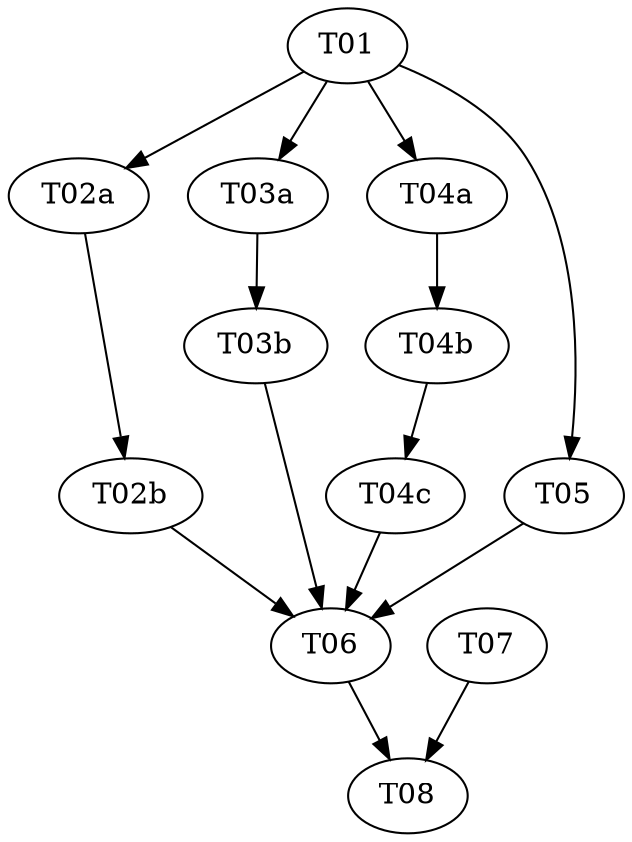

# think-tank 1.0 Implementation Plan

> **For Claude:** REQUIRED SUB-SKILL: Use superpowers:subagent-driven-development (parallel, same session) to implement this plan. It holds `pair` and `triad` tasks, so executing-plans can't run it.

**Goal:** Replace think-tank's global rounds with per-topic moderators, expert instances that argue
through agent inboxes, a shared topic graph with formal closing rules, and locked concurrent
commits, released as 1.0.0.

**Architecture:** `tt.mjs` becomes a thin CLI over six `lib/` modules: four pure (`nodes`,
`topics`, `rules`, `problems`), one that writes (`store`) and the index writer. The role prompts and
`SKILL.md` are rewritten for the composer, registrar, moderators, experts and reporter; curators,
agendas and rounds go.

**Tech Stack:** Node built-ins only, ES modules, `node:test`. Repo:
`C:\work\claude\vanillafairy\think-tank` (branch `master`, its own git repository).

**Spec:** `C:\work\claude\vanillafairy\docs\superpowers\specs\2026-11-03-think-tank-design.md`

**Planned by:** claude-opus-5-5

## Global Constraints

- No dependencies: Node built-ins only, no build step.
- `src`-equivalent code lives in `skills/think-tank/scripts/`; tests in `test/`, run by `node --test test/`.
- Prompts are read by agents doing the work now: present tense, no history, no dates.
- The CLI's main guard compares `realpathSync` of both paths, so it runs through a junction.
- Version `1.0.0` in `.claude-plugin/plugin.json`; a 0.x run can't continue on it and gets no migration.

## Dispatch
| Stage | Model | Effort | Why |
|---|---|---|---|
| final-review | opus | medium | |

## Review Focus

1. Agent ids hold `@` (`save@q-save-3`); a git author email built from one is malformed unless
   escaped → pinned in T04a ('a commit holds only the caller's files, authored by the caller').
2. Frontmatter numbers can arrive as strings (`seq: "12"`) and must compare numerically → pinned in
   T03a ('numbers written as strings still compare as numbers').
3. An agent passes a commit path that isn't a file in the graph (e.g. `graph/x.md` instead of
   `x.md`); it must fail naming the path, not commit nothing silently → pinned in T04a ('a path
   naming no file is refused by name').
4. A writer that crashes holding the lock must not stall every later agent → pinned in T04a ('a
   stale lock older than 30 seconds is broken').
5. A topic needed by several others must not be printed in full repeatedly or recursed forever in
   `index.md` → pinned in T06 ('a topic needed by two roots is expanded once and referenced after that').

---

## Dependency Graph

| Task | Role | Depends On | Files Created/Modified |
|------|------|-----------|------------------------|
| T01  | — | — | `scripts/lib/nodes.mjs`, `scripts/tt.mjs`, `test/nodes.test.mjs`, `test/tt.test.mjs` |
| T02a | red | T01 | `test/topics.test.mjs` (authored here), `scripts/lib/topics.mjs` (stubs) |
| T02b | green | T02a | `scripts/lib/topics.mjs` (`test/topics.test.mjs` READ-ONLY) |
| T03a | red | T01 | `test/rules.test.mjs` (authored here), `scripts/lib/rules.mjs` (stub) |
| T03b | green | T03a | `scripts/lib/rules.mjs` (`test/rules.test.mjs` READ-ONLY) |
| T04a | red | T01 | `test/store.test.mjs`, `test/fixtures/commit-worker.mjs`, `test/fixtures/seq-worker.mjs` (authored here), `scripts/lib/store.mjs` (stubs) |
| T04b | green | T04a | `scripts/lib/store.mjs` (the T04a tests READ-ONLY) |
| T04c | audit | T04b | — (audit only; a gap becomes `tasks/T04d-store-gaps.md`) |
| T05  | — | T01 | `scripts/lib/problems.mjs`, `test/problems.test.mjs` |
| T06  | — | T02b, T03b, T04c, T05 | `scripts/tt.mjs`, `scripts/lib/index-file.mjs`, `test/cli.test.mjs`, deletes `test/tt.test.mjs` |
| T07  | — | — | `roles/*.md`: rewrites graph, expert, moderator, composer, reporter; creates registrar; deletes curator |
| T08  | — | T06, T07 | `SKILL.md`, `README.md`, `.claude-plugin/plugin.json` |

Paths under `scripts/` and `roles/` are inside `skills/think-tank/`.

**Wave Schedule:**
- Wave 1: T01, T07 — controller: sonnet/medium — a module move and the prompts, no shared files
- Wave 2: T02a → T02b, T03a → T03b, T04a → T04b → T04c, T05 — controller: sonnet/high — two red/green chains, the store triad and one tdd task in parallel; the store chain needs care with concurrency. If T04c writes T04d, it runs in this wave before T06
- Wave 3: T06 — controller: sonnet/medium — one wiring task
- Wave 4: T08 — controller: sonnet/low — prose and the version bump

After the final review the orchestrator releases it: update the local install
(`claude plugin marketplace update local-dev`, then `claude plugin update think-tank@local-dev`).
The repository has no remote, so nothing is pushed.

## Task Index

| ID | Name | File | Description |
|----|------|------|-------------|
| T01 | Nodes module | tasks/T01-nodes-module.md | Move parsing into `lib/nodes.mjs`; `topicOf` covers positions, cruxes, ballots |
| T02a | Topic graph — tests | tasks/T02a-topic-graph-tests.md | Pin blocking, completeness, cycles, reopening, the graph report |
| T02b | Topic graph — implementation | tasks/T02b-topic-graph.md | `lib/topics.mjs` against the locked tests |
| T03a | Closing rules — tests | tasks/T03a-closing-rules-tests.md | Pin consensus, crux, stall, loop, cap, escalation, outcome |
| T03b | Closing rules — implementation | tasks/T03b-closing-rules.md | `lib/rules.mjs` against the locked tests |
| T04a | Store — tests | tasks/T04a-store-tests.md | Pin init, the lock, seq, concurrent commits, wakes, verdicts |
| T04b | Store — implementation | tasks/T04b-store.md | `lib/store.mjs` against the locked tests |
| T04c | Store — audit | tasks/T04c-store-audit.md | Mutation sweep of the lock, seq and commit guards |
| T05 | Node problems and coverage | tasks/T05-problems.md | `lib/problems.mjs`: per-node problems, card and cast coverage |
| T06 | CLI and index | tasks/T06-cli-and-index.md | New `tt.mjs` commands and `index.md` over the topic graph |
| T07 | Role prompts | tasks/T07-role-prompts.md | Expert, moderator, registrar, composer, reporter, graph |
| T08 | Skill, README and version | tasks/T08-skill-readme-version.md | The main session's run, the README, 1.0.0 |

## Execution Handoff

**Plan complete and saved to `docs/superpowers/plans/2026-11-03-think-tank-1.0/plan.md`.**

It holds `pair` tasks, so it runs subagent-driven: fresh executors per task in parallel waves,
reviewed before each merge, then one whole-branch review.
